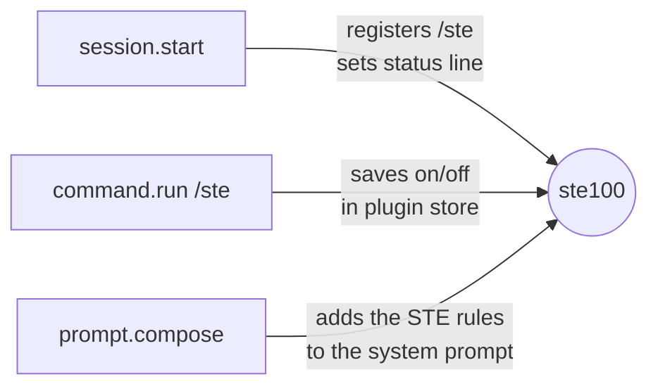

<div align="center">

# ste100

**Clear, short answers from Claude Code — written in ASD-STE100 Simplified Technical English.**

[](LICENSE)
[](https://docs.claude.com/en/docs/claude-code)
[](https://www.asd-ste100.org/)
[](CONTRIBUTING.md)

</div>

---

## Contents

- [What it does](#what-it-does)
- [Why use it](#why-use-it)
- [Before and after](#before-and-after)
- [Install](#install)
- [Usage](#usage)
- [The rules](#the-rules)
- [How it works](#how-it-works)
- [Customize the rules](#customize-the-rules)
- [Uninstall](#uninstall)
- [FAQ](#faq)
- [Contributing](#contributing)
- [License](#license)

## What it does

`ste100` is a plugin for [Claude Code](https://docs.claude.com/en/docs/claude-code). It tells Claude to write every answer in **ASD-STE100 Simplified Technical English** (STE).

STE is a controlled language. The aerospace industry made it for maintenance manuals, so that all readers can understand the text quickly and correctly. This plugin applies the same rules to Claude's answers.

> [!NOTE]
> The plugin changes only Claude's own prose in chat replies. It does not change how Claude codes.

### Safe for coding

| Not affected | Why |
| --- | --- |
| Code, comments, docstrings | They follow your project's conventions. |
| Commit messages, pull request text, docs | They follow your project's conventions. |
| Tool inputs and subagent prompts | Only replies to you change. |
| Commands, paths, identifiers, logs, errors | Quoted exactly. |
| Depth of work | Claude must not skip steps, checks, tests or technical detail to be short. |
| `claude -p` and SDK runs | The plugin is off there, so scripts that parse the output do not break. |

## Why use it

| Benefit | Result |
| --- | --- |
| **Easier to read** | Short sentences, simple words, one meaning for each word. |
| **Faster to use** | The answer comes first. Steps are numbered. |
| **Less context** | No filler, no preambles, no repeated summaries. Shorter answers use fewer tokens. |
| **Better for non-native readers** | STE was designed for readers whose first language is not English. |
| **Consistent** | The same term for the same thing in every answer. |

## Before and after

**Without the plugin:**

> Great question! So basically, what's happening here is that the configuration file is actually being loaded before the environment variables have had a chance to be set, which means that the values you're expecting aren't really there yet. I think the best approach would probably be to move the call to `loadEnv()` so that it happens earlier. Let me know if you'd like me to make that change!

**With the plugin:**

> The app loads the config file before it sets the environment variables. Thus, the values are empty.
>
> To fix this, call `loadEnv()` before `loadConfig()` in `src/main.ts`.

## Install

> [!IMPORTANT]
> You need [Claude Code](https://docs.claude.com/en/docs/claude-code) with plugin support.

**In a Claude Code terminal session**, type:

```text
/plugin install ste100 --marketplace Fanaperana/ste100
```

Type `y` to add the marketplace, then select a scope. The **user** scope enables the plugin in all your sessions.

**From a shell:**

```bash
claude plugin install ste100 --marketplace Fanaperana/ste100
```

**In the Claude desktop app** (`/plugin` does not run there):

1. Click **+** next to the prompt box, then **Plugins**.
2. Click **Add marketplace** and type `Fanaperana/ste100`.
3. Click **Add plugin** and select **ste100**.

The plugin is active after the install. STE style is **on** by default.

## Usage

| Command | Effect |
| --- | --- |
| `/ste` | Toggle the STE style on or off. |
| `/ste on` | Turn the STE style on. |
| `/ste off` | Turn the STE style off. |

- The change applies from your next message.
- Your choice is kept across sessions.
- While the style is on, the status line shows **`STE100`**.

## The rules

The plugin gives Claude these rules. They are adapted from the ASD-STE100 specification for chat answers.

<details>
<summary><b>Scope and priorities</b></summary>

- The rules apply only to Claude's prose in chat replies.
- Code, comments, commit messages, pull request text, documentation and other file content follow the project's conventions.
- Tool inputs, subagent prompts and quoted text do not change.
- Code blocks, diffs, tables and file lists keep their normal format.
- Claude must not skip steps, checks, tests, caveats or technical detail to make a reply shorter.
- Correct and complete information comes before short text.
- If you ask for a different style, length or format, Claude follows you.

</details>

<details>
<summary><b>Words</b></summary>

- Use simple, common words. Use one word for one meaning, and use the same word for the same thing every time.
- Use exact technical terms (names of files, functions, APIs, errors, tools). Do not replace them with simpler words. Do not invent jargon or abbreviations.
- Use verbs as verbs. Write "examine the log", not "do an examination of the log".
- Do not use filler, hedges or intensifiers ("basically", "actually", "really", "just", "I think").

</details>

<details>
<summary><b>Sentences</b></summary>

- Procedural sentences (instructions, steps): 20 words or fewer.
- Descriptive sentences (explanations): 25 words or fewer.
- One instruction per sentence, unless two actions occur at the same time.
- Use the active voice. Write "The script deletes the cache", not "The cache is deleted".
- Use the imperative for instructions: "Run the tests."
- Use simple verb tenses: present, simple past, simple future.
- Do not omit articles (a, an, the) or verbs to make text shorter.
- Write warnings and cautions as a clear command first, then a short reason.

</details>

<details>
<summary><b>Structure</b></summary>

- Put the result or answer first.
- Paragraphs: one topic, 6 sentences or fewer.
- Use numbered lists for sequential steps and bulleted lists for items that have no order.
- Do not repeat information. Do not add a summary of what you already said.
- Do not use preambles or meta-commentary ("Here is...", "Let me explain...").

</details>

## How it works

The plugin is a Claude Code hooks module ([`plugin/hooks/register.ts`](plugin/hooks/register.ts)). It uses three hooks:



1. **`session.start`** registers the `/ste` command and shows `STE100` in the status line.
2. **`command.run`** handles `/ste`, and saves your choice in the plugin's persistent store.
3. **`prompt.compose`** adds one section, `ste100:style`, at the end of the system prompt when the style is on. It adds nothing in `claude -p` and SDK runs.

The section goes after the prompt cache boundary (`scope: 'session'`). Thus, the shared prompt cache is not affected.

### Repository layout

```text
ste100/
├── .claude-plugin/
│   └── marketplace.json      # makes this repository a plugin marketplace
├── plugin/
│   ├── .claude-plugin/
│   │   └── plugin.json       # plugin manifest
│   └── hooks/
│       ├── hooks.json        # names the hooks module
│       ├── register.ts       # the rules and the hooks
│       └── register.test.ts  # tests
├── .github/                  # issue and pull request templates
├── CONTRIBUTING.md
├── CODE_OF_CONDUCT.md
├── SECURITY.md
├── SUPPORT.md
├── CHANGELOG.md
└── LICENSE
```

## Customize the rules

1. Clone the repository:
   ```bash
   git clone https://github.com/Fanaperana/ste100.git
   ```
2. Edit the `STE_RULES` text in [`plugin/hooks/register.ts`](plugin/hooks/register.ts).
3. Check and test the plugin:
   ```bash
   claude plugin validate ste100/plugin
   claude plugin test ste100/plugin
   ```
4. Run Claude Code with your local copy:
   ```bash
   claude --plugin-dir ste100/plugin
   ```

## Uninstall

```bash
claude plugin uninstall ste100
```

To keep the plugin installed but stop the style, type `/ste off`.

## FAQ

<details>
<summary><b>Does it change code that Claude writes?</b></summary>

No. The rules apply only to Claude's prose. Code, commands, paths, identifiers and quoted text do not change.

</details>

<details>
<summary><b>Does it make Claude less capable?</b></summary>

No. The plugin changes only the writing style of the answers. It does not remove or change other instructions, tools or skills. The rules tell Claude not to drop steps, checks or technical detail to be short.

</details>

<details>
<summary><b>Does it work with output styles?</b></summary>

Yes. The STE section is added after the other sections of the system prompt, so it works together with your output style. If the two styles disagree, try `/ste off`.

</details>

<details>
<summary><b>Is this the official ASD-STE100 specification?</b></summary>

No. ASD-STE100 is a specification from ASD (AeroSpace and Defence Industries Association of Europe). It includes a dictionary of approved words. This plugin uses a short summary of its main writing rules, adapted for chat. It does not include the dictionary. For the full specification, go to [asd-ste100.org](https://www.asd-ste100.org/).

</details>

## Contributing

Contributions are welcome. Read [CONTRIBUTING.md](CONTRIBUTING.md) before you open a pull request. This project follows a [Code of Conduct](CODE_OF_CONDUCT.md).

- Found a bug? [Open a bug report](https://github.com/Fanaperana/ste100/issues/new?template=bug_report.yml).
- Have an idea? [Request a feature](https://github.com/Fanaperana/ste100/issues/new?template=feature_request.yml).
- Found a security problem? Read [SECURITY.md](SECURITY.md).

## License

[MIT](LICENSE) © 2026 Fanaperana

ASD-STE100 is a trademark of ASD. This project is not affiliated with or endorsed by ASD.
